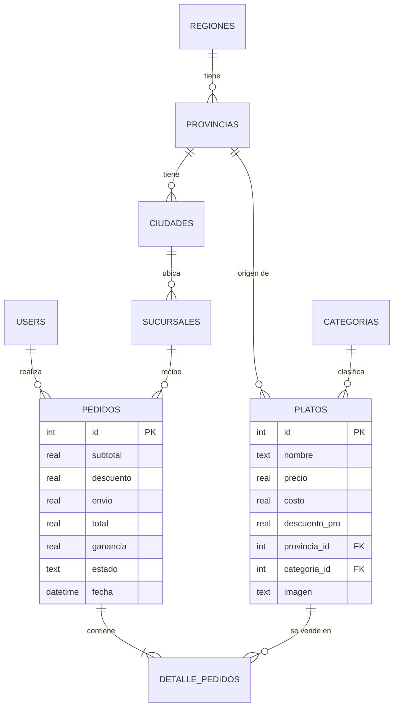

<h1 align="center">🔥 Fuego Andino</h1>

<p align="center">
  Sistema web MVC para una franquicia ficticia de restaurantes de <b>comida 100% ecuatoriana</b>:<br>
  menú por región, cuentas con roles, pedidos y un panel de administración con gráficos en tiempo real.
</p>

<p align="center">
  
  
  
  
  
</p>

<p align="center">
  <a href="https://youtu.be/acrYkLYtchI"><b>▶ Ver el video explicativo</b></a>
</p>

---

## Contenido

1. [Qué hace el sistema](#1-qué-hace-el-sistema)
2. [Cumplimiento de la tarea](#2-cumplimiento-de-la-tarea)
3. [Reglas de negocio](#3-reglas-de-negocio)
4. [Arquitectura](#4-arquitectura)
5. [Modelo de datos](#5-modelo-de-datos)
6. [Seguridad](#6-seguridad)
7. [Instalación y ejecución](#7-instalación-y-ejecución)
8. [Cuentas de prueba](#8-cuentas-de-prueba)
9. [Rutas](#9-rutas)
10. [Deploy](#10-deploy)
11. [Créditos de las fotos](#11-créditos-de-las-fotos)
12. [Autor y licencia](#12-autor-y-licencia)

---

## 1. Qué hace el sistema

| Perfil | Qué puede hacer |
| --- | --- |
| **Invitado** | Ver la portada, el menú por región y categoría, y la página *Nosotros*. No puede pedir. |
| **Cliente Free** | Todo lo anterior y hacer pedidos (precio regular + $2.50 de envío). |
| **Cliente Pro** | Pedidos con el descuento propio de cada plato y envío gratis. |
| **Administrador** | Gestionar el **catálogo de platos** y las **sucursales**, y consultar el **dashboard** con ventas, ganancias, demanda y clientes. |

**Sitio público:** portada con carrusel de platos destacados, menú con mosaico de regiones y categorías, y fotos reales de cada plato. Es responsive (móvil, tablet y escritorio).

**Panel de administración:**
- CRUD de platos con foto, región → provincia en cascada, categoría, precio, costo y descuento Pro.
- CRUD de sucursales con ubicación en cascada región → provincia → ciudad.
- Dashboard que se actualiza solo cada 4 segundos: ventas, ganancia, pedidos, clientes Free/Pro, platos más y menos pedidos, ventas por sucursal y comparación con el período anterior.

---

## 2. Cumplimiento de la tarea

| Requisito de la asignación | Estado | Dónde está |
| --- | :---: | --- |
| Administración MVC basada en el core aprobado | ✅ | `app/controllers`, `app/models`, `app/views` |
| **Validación en back-end** de un dato sensible antes de guardar | ✅ | `PlatoController::validar()` — precio, costo y descuento (el costo debe ser menor que el precio, el precio Pro nunca baja del costo, rangos, nombre único). También valida la foto subida. |
| **Referencias entre tablas con dropdowns**, sin ingresar claves foráneas a mano | ✅ | Platos: región → provincia (+ categoría). Sucursales: región → provincia → ciudad. Las listas se cargan por `fetch` desde `?action=provincias` y `?action=ciudades`, y el servidor vuelve a comprobar la relación. |
| Código versionado en Git con README | ✅ | Este repositorio |
| Deployado | ⏳ | Ver [Deploy](#10-deploy) · **URL:** _pendiente de completar_ |
| Video en Loom/YouTube | ✅ | [youtu.be/acrYkLYtchI](https://youtu.be/acrYkLYtchI) |

> **Qué se valida en el servidor y por qué:** precio, costo y descuento son los datos sensibles del core, porque de ellos sale la ganancia que muestra el dashboard. Un plato con pérdida o con un descuento fuera de rango distorsionaría todos los indicadores, así que el servidor lo rechaza aunque el navegador envíe datos manipulados.

---

## 3. Reglas de negocio

Definidas en el documento de especificación funcional y calculadas en `Pedido::create()` y `Dashboard`:

```text
Subtotal         = Σ (precio del plato × cantidad)
Descuento Pro    = Σ (precio × cantidad × descuento_pro del plato / 100)      solo si el cliente es Pro
Envío            = $0.00 si es Pro · $2.50 si es Free
Total del pedido = Subtotal − Descuento Pro + Envío
Ganancia         = Total del pedido − Σ (costo de elaboración × cantidad)

Ventas del período    = Σ Total de pedidos no cancelados
Ganancia del período  = Σ Ganancia de pedidos no cancelados
Platos más/menos pedidos = unidades vendidas por plato (sin contar pedidos cancelados)
```

Los precios y costos siempre se leen de la base de datos al registrar un pedido; nunca vienen del formulario.

---

## 4. Arquitectura

Patrón **MVC** en PHP nativo, con un *front controller* (`index.php`) que recibe todas las peticiones, valida el token CSRF y las despacha mediante una tabla de rutas.

```text
tarea3_mvc/
├── index.php                  # Front controller: sesión, rutas, CSRF y autocarga de clases
├── Dockerfile                 # Imagen para deploy (php:8.3-apache)
├── config/
│   ├── database.php           # Conexión PDO, esquema, migraciones y siembra de datos
│   └── seed_data.php          # Datos de ejemplo (usuarios, geografía, platos, sucursales)
├── app/
│   ├── helpers.php            # e(), CSRF, redirect(), flash(), formato de dinero
│   ├── controllers/           # Auth, Home, Menu, Plato, Sucursal, Dashboard
│   ├── models/                # User, Plato, Categoria, Geografia, Sucursal, Pedido, Dashboard
│   └── views/                 # login, home, menu, about, dashboard, plato_form, sucursal_form, partials/
├── assets/
│   ├── css/app.css            # Estilos del sitio público y del panel
│   ├── js/chart.umd.min.js    # Chart.js incluido localmente (no depende de un CDN)
│   └── img/                   # Logo, fotos de platos y creditos.json
└── docs/                      # Wireframes del documento de especificación
```

**Flujo de una petición:** `index.php?action=menu` → tabla de rutas → `MenuController::index()` → modelos (`Plato`, `Sucursal`) → vista `menu.php`.

---

## 5. Modelo de datos



La base `data.sqlite` **se crea sola** la primera vez que se abre el sitio (esquema, migraciones para bases antiguas y datos de ejemplo). Por eso no está versionada.

---

## 6. Seguridad

- **Validación en servidor** de todos los formularios (no se confía en JavaScript).
- **Sentencias preparadas (PDO)** en todas las consultas que reciben datos externos.
- **Protección CSRF**: cada formulario POST lleva un token de sesión que `index.php` verifica.
- **Escape de salida** con `e()` (`htmlspecialchars`) en todas las vistas, contra XSS.
- **Sesiones**: cookie `HttpOnly` + `SameSite=Lax` y `session_regenerate_id()` al iniciar sesión.
- **Control de acceso por rol**: las rutas de administración redirigen al login si el rol no es `admin`.
- **Subida de fotos**: se valida tamaño (≤ 2 MB), tipo real del contenido con `getimagesize()` (no la extensión), dimensiones, y se guarda con nombre aleatorio.
- **Integridad**: una sucursal o un plato con pedidos no se borra, se desactiva, para no romper el historial.

> ⚠️ **Contraseñas con MD5:** se mantiene únicamente por el requisito de la Tarea 3 de este proyecto. En un sistema real debe usarse `password_hash()` / `password_verify()`.
> El acceso rápido por rol del login (`?action=switch_user`) es solo para la demostración y debe eliminarse en producción.

---

## 7. Instalación y ejecución

**Requisitos:** PHP 8.1 o superior con la extensión `pdo_sqlite` (viene activada por defecto).

```bash
git clone https://github.com/ArielGitHuub/Crud-Login.git
cd Crud-Login
php -S localhost:8000
```

Abre <http://localhost:8000>. No hay que instalar dependencias ni crear la base de datos.

---

## 8. Cuentas de prueba

Todas usan la contraseña **`1234`**.

| Usuario | Rol | Plan |
| --- | --- | --- |
| `admin` | Administrador | Pro |
| `cliente_pro` | Cliente | Pro |
| `cliente_free` | Cliente | Free |
| `lucia`, `sofia`, `mateo` | Cliente | Free |
| `diego` | Cliente | Pro |

El login también tiene botones de **acceso rápido** (Administrador, Cliente Pro, Cliente Free, Invitado).

---

## 9. Rutas

Todas se acceden como `index.php?action=<ruta>`.

| Ruta | Acceso | Descripción |
| --- | --- | --- |
| `login`, `logout` | Todos | Entrada del sitio (siempre se muestra primero) |
| `inicio`, `nosotros` | Todos | Portada con carrusel · información del restaurante |
| `menu` | Todos | Menú filtrable por `region` y `categoria` |
| `ordenar` (POST) | Cliente | Registra un pedido |
| `dashboard`, `dashboard_data` | Admin | Panel y JSON para el refresco en tiempo real |
| `platos`, `provincias` | Admin | CRUD de platos · JSON de provincias por región |
| `sucursales`, `ciudades` | Admin | CRUD de sucursales · JSON de ciudades por provincia |

---

## 10. Deploy

PHP necesita un servidor con soporte PHP; `php -S` es solo para desarrollo. El repositorio incluye un `Dockerfile` (`php:8.3-apache`), así que funciona en [Render](https://render.com), Railway o cualquier servicio que despliegue contenedores.

**En Render (plan gratuito):**

1. *New +* → *Web Service* → conectar este repositorio de GitHub.
2. *Language / Runtime:* **Docker** (detecta el `Dockerfile`).
3. *Instance type:* **Free** → *Create Web Service*.

> En el plan gratuito el disco es temporal: los datos creados se reinician al redesplegar, pero la base se regenera sola con los datos de ejemplo.

- **URL desplegada:** _pendiente de completar_

---

## 11. Créditos de las fotos

Las fotos de los platos son **reales** y provienen de [Wikimedia Commons](https://commons.wikimedia.org), con licencias libres que exigen atribución. También se muestran en la página *Nosotros* del sitio. El archivo `assets/img/creditos.json` guarda estos datos.

| Plato | Foto | Autor | Licencia |
| --- | --- | --- | --- |
| Encebollado Mixto | [Encebollado mixtoo.jpg](https://commons.wikimedia.org/wiki/File:Encebollado_mixtoo.jpg) | Montielec98 | [CC BY-SA 4.0](https://creativecommons.org/licenses/by-sa/4.0) |
| Seco de Chivo | [Seco de chivo (gastronomía Ecuatoriana).jpg](https://commons.wikimedia.org/wiki/File:Seco_de_chivo_(gastronom%C3%ADa_Ecuatoriana).jpg) | Kevinmero | [CC BY-SA 4.0](https://creativecommons.org/licenses/by-sa/4.0) |
| Ceviche de Camarón | [Ceviche de camarón ecuatoriano.jpg](https://commons.wikimedia.org/wiki/File:Ceviche_de_camar%C3%B3n_ecuatoriano.jpg) | Ceibos | [CC BY-SA 4.0](https://creativecommons.org/licenses/by-sa/4.0) |
| Locro de Papa | [Locro de papa.jpg](https://commons.wikimedia.org/wiki/File:Locro_de_papa.jpg) | J. Miers - Jtesla16 | [CC BY-SA 3.0](https://creativecommons.org/licenses/by-sa/3.0) |
| Hornado con Llapingachos | [AMA Cotopaxi Hornado (19)](https://commons.wikimedia.org/wiki/File:AMA_Cotopaxi_Hornado_(19)_(14111642599).jpg) | amalavida.tv | [CC BY-SA 2.0](https://creativecommons.org/licenses/by-sa/2.0) |
| Guatita Quiteña | [Guatita (gastronomía Ecuatoriana).jpg](https://commons.wikimedia.org/wiki/File:Guatita_(gastronom%C3%ADa_Ecuatoriana).jpg) | Kevinmero | [CC BY-SA 4.0](https://creativecommons.org/licenses/by-sa/4.0) |
| Cevichocho | [Ceviche de chochos con pollo (gastronomía Ecuatoriana).jpg](https://commons.wikimedia.org/wiki/File:Ceviche_de_chochos_con_pollo_(gastronom%C3%ADa_Ecuatoriana).jpg) | Kevinmero | [CC BY-SA 4.0](https://creativecommons.org/licenses/by-sa/4.0) |
| Empanadas de Viento | [Empanadas de viento (gastronomía Ecuatoriana).jpg](https://commons.wikimedia.org/wiki/File:Empanadas_de_viento_(gastronom%C3%ADa_Ecuatoriana).jpg) | Kevinmero | [CC BY-SA 4.0](https://creativecommons.org/licenses/by-sa/4.0) |
| Colada Morada | [Colada morada y guaguas de pan](https://commons.wikimedia.org/wiki/File:COLADA_MORADA_Y_GUAGUAS_DE_PAN_(38016386062).jpg) | Agencia de Noticias ANDES | [CC BY-SA 2.0](https://creativecommons.org/licenses/by-sa/2.0) |
| Horchata Lojana | [Vaso de horchata lojana.jpg](https://commons.wikimedia.org/wiki/File:Vaso_de_horchata_lojana.jpg) | SimonLuzuriaga | [CC BY-SA 4.0](https://creativecommons.org/licenses/by-sa/4.0) |
| Canelazo | [Canelazo.jpg](https://commons.wikimedia.org/wiki/File:Canelazo.jpg) | momentcaptured1 | [CC BY 2.0](https://creativecommons.org/licenses/by/2.0) |
| Maito de Tilapia | [Maito de Tilapia.jpg](https://commons.wikimedia.org/wiki/File:Maito_de_Tilapia.jpg) | Iestrella | [CC BY-SA 4.0](https://creativecommons.org/licenses/by-sa/4.0) |
| Ayampaco | [Ayampaco.jpg](https://commons.wikimedia.org/wiki/File:Ayampaco.jpg) | David C. S. | [CC BY-SA 4.0](https://creativecommons.org/licenses/by-sa/4.0) |

Las fotos fueron reducidas de tamaño para la web. El código fuente es MIT; las fotos conservan la licencia de cada autor.

---

## 12. Autor y licencia

**Ariel Tejada** — Ingeniería de Software, Universidad de Las Américas (UDLA). Asignatura: Ingeniería Web.

Código bajo licencia [MIT](LICENSE).
